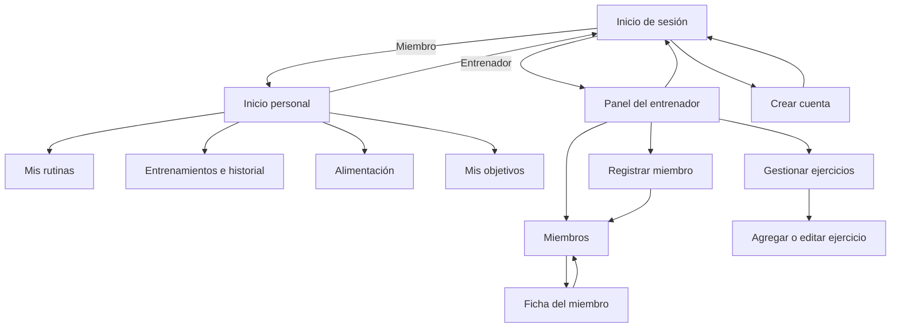

# SPORT CONTROL: mapa de navegación

## Flujo de acceso

## Pantallas y acciones

| Pantalla | Rol | Acciones principales |
| --- | --- | --- |
| Inicio de sesión | Público | Ingresar como miembro o entrenador; ir a crear cuenta. |
| Crear cuenta | Público | Capturar nombre, correo y contraseña de demostración; volver al acceso. |
| Inicio | Ambos | Ver resumen; navegar a las funciones del rol. |
| Miembros | Entrenador | Buscar, filtrar y abrir una ficha. |
| Gestionar ejercicios | Entrenador | Agregar o editar ejercicios y su detalle dentro de una rutina. |
| Registrar miembro | Entrenador | Capturar datos básicos y guardar en la sesión de demostración. |
| Ficha del miembro | Entrenador | Consultar avance y asignar una rutina de demostración. |
| Mis rutinas | Miembro | Consultar rutinas, usar el temporizador y marcar un día completado. |
| Entrenamientos | Miembro | Registrar ejercicio y repeticiones; consultar historial. |
| Alimentación | Miembro | Agregar comidas al registro diario de demostración. |
| Mis objetivos | Miembro | Actualizar meta y medidas de seguimiento. |

## API usada por el prototipo

La interfaz consulta `GET /api/rutinas`, `GET /api/entrenamientos` y `GET /api/ejercicios`, registra sesiones con `POST /api/entrenamientos` y permite crear o actualizar ejercicios con `POST /api/ejercicios` y `PUT /api/ejercicios/:id`. Los ejercicios se pueden filtrar por rutina y día con `routineId` y `day`, y se mantienen en memoria mientras el servidor esté activo. Miembros, alimentación y objetivos son datos de demostración.

Para probarlo localmente, inicia todo el sitio desde la raíz con `npm.cmd start` y abre `http://localhost:3000`. Desde la raíz, `npm.cmd test` ejecuta las pruebas de las dos APIs del proyecto.

## Criterios básicos de usabilidad y accesibilidad

- Cada vista tiene un título y se alcanza desde navegación visible según el rol.
- Los formularios tienen etiquetas, tipos de campo y validación nativa del navegador.
- El menú móvil declara su estado expandido; los controles muestran foco visible.
- Los avisos dinámicos usan regiones de estado para que puedan anunciarse con tecnologías de asistencia.
- El diseño adapta tarjetas y formularios a pantallas pequeñas y respeta la preferencia de movimiento reducido.
- El acceso y el registro son simulados: no se almacenan contraseñas ni se autentica contra un servicio.

## Plantilla visual

La interfaz usa Materialize CSS 1.0.0 para algunas superficies `card-panel` y aplica el estilo visual del archivo de referencia: tipografía Barlow, paleta azul con acento amarillo, cabecera compacta y diseño adaptable con modo oscuro del sistema. La hoja de Materialize y las fuentes se cargan desde CDN; para mostrarlas se requiere conexión a internet.

## Publicación

El archivo `render.yaml` prepara un servicio web de Render desde la raíz del repositorio. Sube el proyecto a un repositorio de GitHub, crea un Blueprint en Render y conecta ese repositorio para obtener una URL `onrender.com`.

Esta configuración usa el plan gratuito para demostración. Render puede suspender instancias gratuitas tras inactividad y los datos de entrenamientos están guardados en memoria, por lo que se reinician al detener o volver a desplegar el servidor. El prototipo no implementa autenticación ni privacidad entre usuarios; no ingreses información personal. Consulta [las limitaciones del plan gratuito de Render](https://render.com/docs/free).
